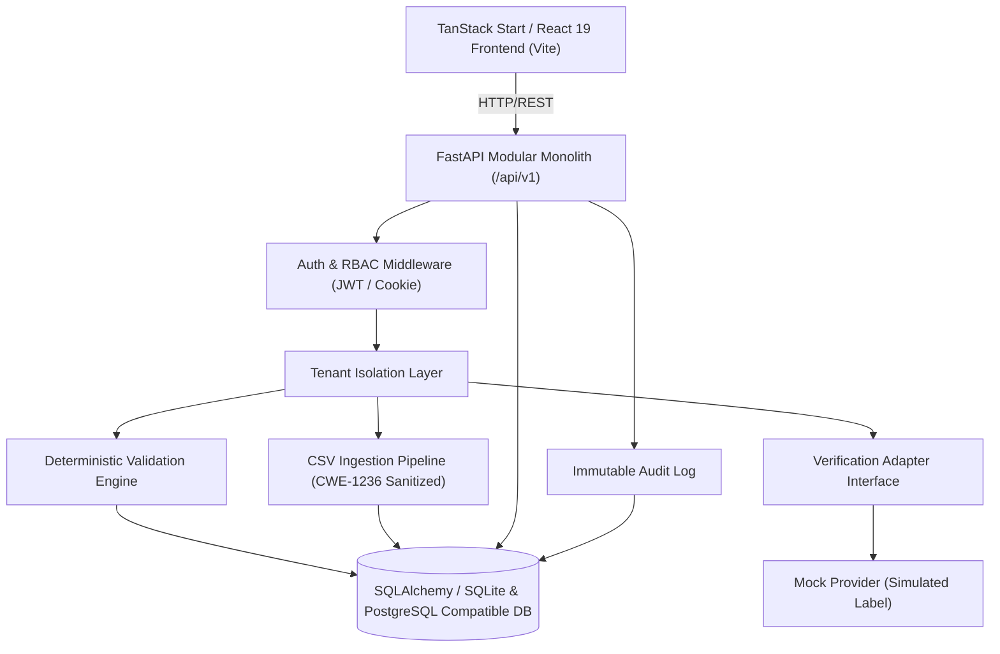

# SIH26263 — System Architecture

## Overview
This platform implements an APAAR ID-based student data management, intake verification, and compliance monitoring system for AICTE-approved institutions.

The architecture is designed as a **modular monolith** with clear separation of concerns, strict tenant data isolation, server-side authorization on every endpoint, and transparent provider boundary adapters.

## Key Architectural Principles

1. **Shared Workspace Shell**: All authenticated institutional workflow pages live under the `_workspace` pathless layout, sharing the consistent institutional header, collapsed sidebar navigation, and demo banner.
2. **Deny-by-Default Security & Tenant Isolation**: Every request is authenticated on the server. Institution users (`institution_admin`, `institution_operator`) are strictly scoped to their own `institution_id`. Modifying a student or batch ID across institutions yields `403 Forbidden`.
3. **Internal UUID Identity Separation**: Students are assigned internal UUID primary keys. APAAR is never used as the database primary key. Student identity is stored separately from historical admission records.
4. **Data Privacy & Identifier Masking**: Full APAAR identifiers are never displayed in URLs, logged in plain text, or returned unmasked in general queries. Only masked forms (`•••• •••• {last4}`) are rendered.
5. **Deterministic Rule Engine**: Explainable rule evaluations produce transparent `ValidationFinding` records with clear codes (`R-REQ-01`, `R-FMT-02`, `R-DUP-01`, `R-CROSS-01`, `R-INT-01`), severity levels, evidence statements, and recommended next steps.
6. **External Verification Isolation**: The verification adapter defines an abstract interface separating application business logic from external identity gateways. Simulated mock responses are unambiguously labelled `SIMULATED — NOT OFFICIAL APAAR VERIFICATION`.
7. **Immutable Audit Trail**: Administrative, ingestion, authentication, and review actions automatically append structured, non-sensitive audit logs that cannot be altered or removed by ordinary users.
