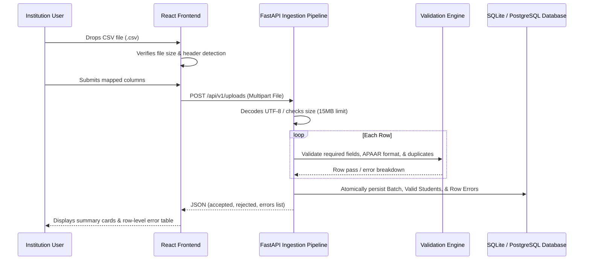

# SIH26263 — CSV Ingestion Pipeline

## Overview
The platform supports institutional bulk onboarding of student admission data through an explainable, 4-step CSV upload workflow.



## Template Specification

Expected CSV header fields:
```csv
student_name,apaar_id,programme_code,academic_year,admission_category,admission_status,date_of_birth
"Ananya Iyer","100000000001","BT-CSE","2026–27","General","Admitted","2006-04-12"
```

| Field Name | Type | Required | Description | Example |
|---|---|:---:|---|---|
| `student_name` | String | Yes | Full legal name of student (min 2 chars) | `Ananya Iyer` |
| `apaar_id` | String | Yes | 12-digit numeric identifier | `100000000001` |
| `programme_code` | String | Yes | Approved programme code | `BT-CSE` |
| `academic_year` | String | Optional | Academic admission cycle | `2026–27` |
| `admission_category` | String | Optional | Category (General, Supernumerary, NRI, OCI, Foreign National) | `General` |
| `admission_status` | String | Optional | Admitted, Pending, Cancelled | `Admitted` |
| `date_of_birth` | String | Optional | Date of birth in YYYY-MM-DD | `2006-04-12` |

## Pipeline Robustness Features

1. **Format Validation**:
   - Strips non-digit formatting characters from identifiers.
   - Enforces exactly 12 digits.
2. **Duplicate Detection Within File**:
   - Rejects duplicate occurrences of the same identifier in the same upload.
3. **Atomic Persistence**:
   - All valid student identities, admissions, and upload batch metadata are persisted in a database transaction.
4. **Row-Level Error Export**:
   - If rows are rejected, an error report CSV is available for download with exact row numbers, field names, and triggered rules.
5. **CSV Formula Injection Sanitization**:
   - Values beginning with `=`, `+`, `-`, or `@` are prefixed with `'` during error export generation.
