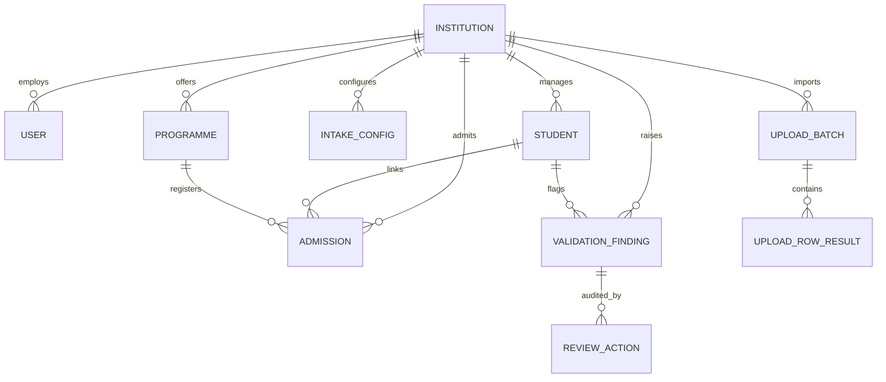

# SIH26263 — Database Schema & Data Model

## Relational Entity Model

## Entity Details

### 1. `institutions`
- `id`: VARCHAR(64) PK (e.g. `INS-001`)
- `name`: VARCHAR(255) NOT NULL
- `ref`: VARCHAR(64) UNIQUE (e.g. `DEMO-AICTE-0001`)
- `state`: VARCHAR(64) NOT NULL
- `status`: VARCHAR(32) NOT NULL (`Active`, `Under review`, `Suspended`)
- `created_at`, `updated_at`: TIMESTAMPTZ (UTC)

### 2. `users`
- `id`: VARCHAR(36) PK (UUID)
- `username`: VARCHAR(64) UNIQUE NOT NULL
- `email`: VARCHAR(128) UNIQUE NOT NULL
- `hashed_password`: VARCHAR(255) NOT NULL (Bcrypt)
- `full_name`: VARCHAR(128) NOT NULL
- `role`: VARCHAR(32) NOT NULL (`institution_admin`, `institution_operator`, `central_reviewer`, `authorized_verifier`, `system_admin`)
- `institution_id`: FK -> `institutions.id` (Nullable for central/system roles)
- `is_active`: BOOLEAN DEFAULT TRUE

### 3. `programmes`
- `id`: VARCHAR(36) PK (UUID)
- `code`: VARCHAR(32) NOT NULL (e.g. `BT-CSE`)
- `name`: VARCHAR(128) NOT NULL
- `academic_year`: VARCHAR(16) NOT NULL (e.g. `2026–27`)
- `approved_intake`: INTEGER NOT NULL (e.g. 180)
- `institution_id`: FK -> `institutions.id`
- `policy`: VARCHAR(64) (`Supernumerary excluded`, etc.)

### 4. `students`
- `id`: VARCHAR(36) PK (e.g. `STU-1001`)
- `internal_uuid`: VARCHAR(36) UNIQUE NOT NULL
- `institution_id`: FK -> `institutions.id` NOT NULL
- `name`: VARCHAR(128) NOT NULL
- `dob`: VARCHAR(16) NOT NULL (`YYYY-MM-DD`)
- `gender`: VARCHAR(16) NOT NULL
- `email`: VARCHAR(128)
- `masked_apaar`: VARCHAR(32) NOT NULL (`•••• •••• 9012`)
- `apaar_hash`: VARCHAR(64) INDEX (SHA-256 for duplicate lookup without plaintext storage)
- `status`: VARCHAR(32) (`Verified`, `Pending review`, `Flagged`, `Correction requested`, `Draft`)

### 5. `admissions`
- `id`: VARCHAR(36) PK (UUID)
- `student_id`: FK -> `students.id` NOT NULL
- `programme_id`: FK -> `programmes.id` NOT NULL
- `institution_id`: FK -> `institutions.id` NOT NULL
- `academic_year`: VARCHAR(16) NOT NULL
- `admission_year`: INTEGER NOT NULL
- `category`: VARCHAR(32) NOT NULL (`General`, `Supernumerary`, `NRI`, `OCI`, `Foreign National`)
- `admission_status`: VARCHAR(32) NOT NULL (`Admitted`, `Pending`, `Cancelled`)
- `is_nri`: BOOLEAN DEFAULT FALSE
- `is_oci`: BOOLEAN DEFAULT FALSE
- `oci_card_number`: VARCHAR(64) NULLABLE
- `is_foreign`: BOOLEAN DEFAULT FALSE
- `nationality`: VARCHAR(64) NULLABLE

### 6. `intake_configs`
- `id`: VARCHAR(36) PK
- `institution_id`: FK -> `institutions.id` NOT NULL
- `academic_year`: VARCHAR(16) NOT NULL
- `supernumerary_excluded`: BOOLEAN DEFAULT TRUE
- `nri_counted_separately`: BOOLEAN DEFAULT FALSE
- `oci_special_quota`: BOOLEAN DEFAULT FALSE
- `warn_threshold_pct`: INTEGER DEFAULT 95
- `max_overrun_allowed`: INTEGER DEFAULT 0

### 7. `upload_batches` & `upload_row_results`
- Track bulk CSV file ingestion, status (`Completed`, `Completed with errors`, `Failed`), totals, accepted count, rejected count, and individual row-level errors (`row_number`, `field`, `raw_value`, `rule`).

### 8. `validation_findings` & `review_actions`
- `validation_findings`: Explainable validation findings with `rule`, `evidence`, `severity` (`High`, `Medium`, `Low`), `status` (`Open`, `Under review`, `Resolved`, `Escalated`).
- `review_actions`: Audit logs of reviewer transitions, notes, and timestamps.

### 9. `verification_attempts`
- Audit log of each format, internal, and external verification check.

### 10. `audit_events`
- Tamper-resistant log of all critical platform operations (`Signed in`, `Created student`, `Uploaded CSV batch`, `Changed intake configuration`, `Exported report`).
